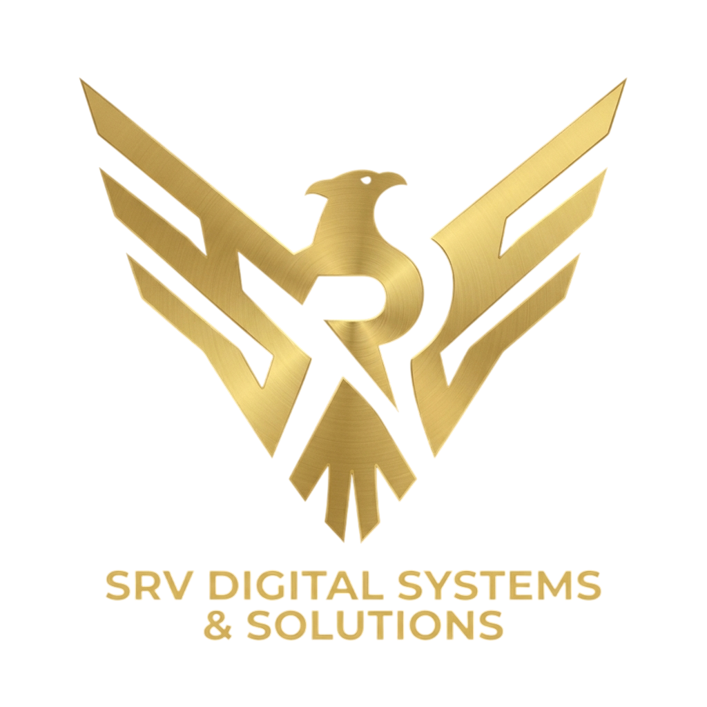
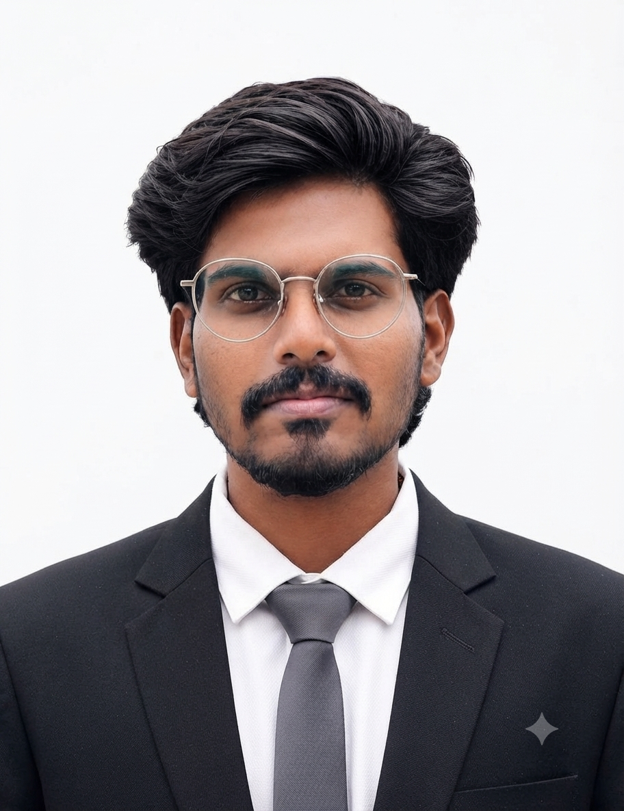
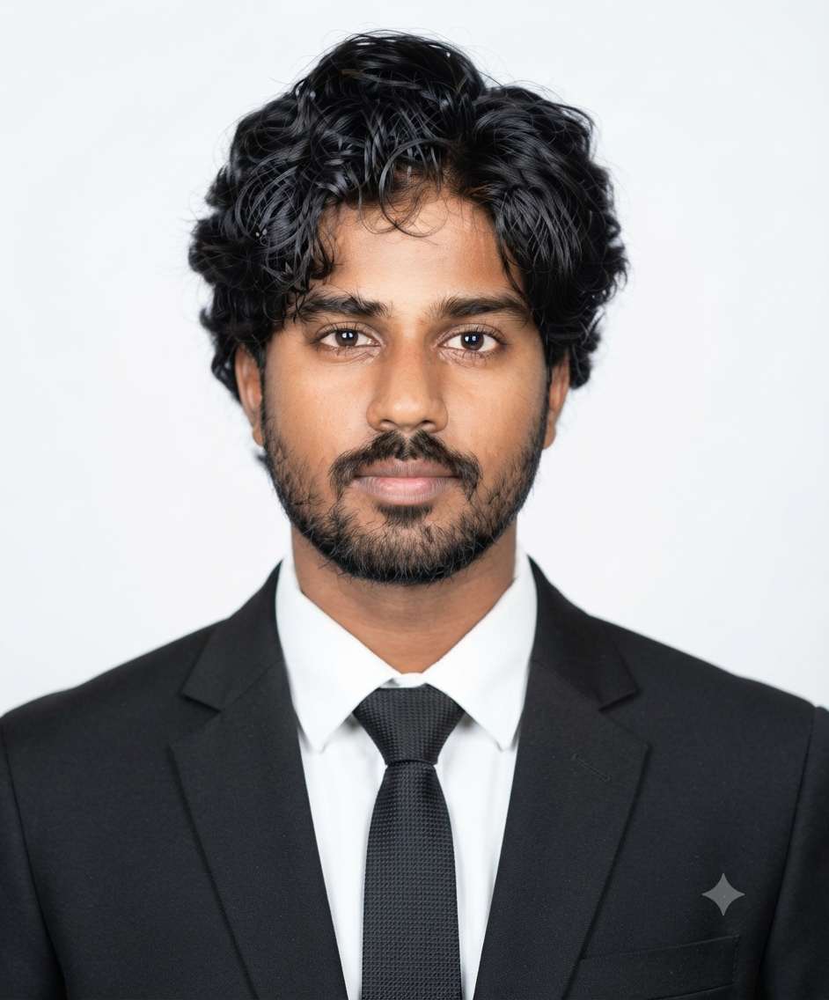
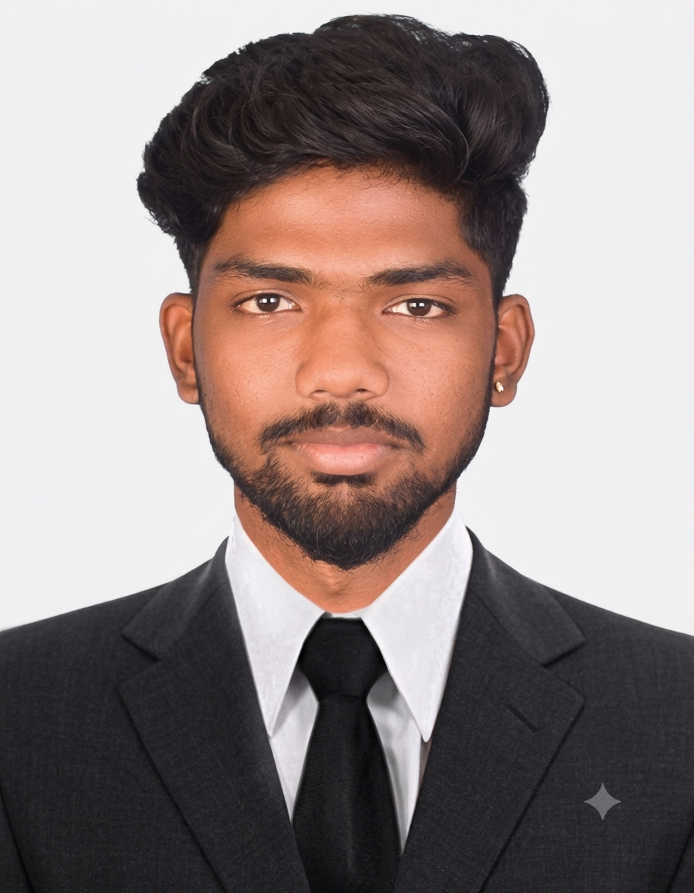
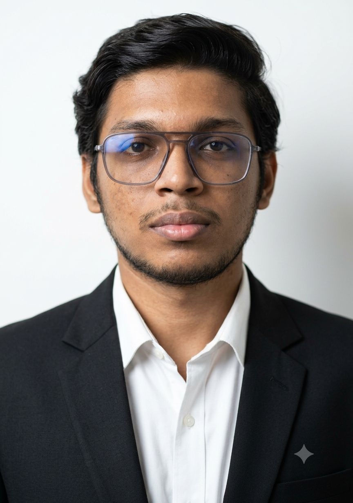
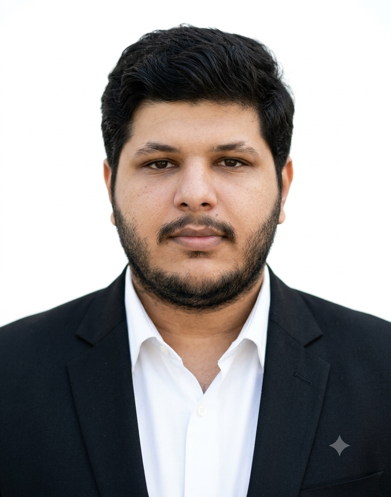

### Secure Systems. Reliable Solutions. Delivered.

 

 

  

**[ What We Do ](#what-we-do)** &nbsp;·&nbsp; **[ Team ](#team)** &nbsp;·&nbsp; **[ Capabilities ](#capabilities)** &nbsp;·&nbsp; **[ Services ](#services)** &nbsp;·&nbsp; **[ Recent Work ](#recent-work)** &nbsp;·&nbsp; **[ What We Don't Do ](#what-we-dont-do)** &nbsp;·&nbsp; **[ Process ](#process)** &nbsp;·&nbsp; **[ Pricing ](#pricing)** &nbsp;·&nbsp; **[ FAQ ](#faq)** &nbsp;·&nbsp; **[ Contact ](#contact)**

 

*Last updated: October 2026*

## 🧭 What We Do

**SRV Digital Systems & Solutions** is a Chennai-based technology consultancy. We are a curator-led specialist network: eight independent specialists in software, security, AI, embedded hardware, marketing operations, media and manufacturing, coordinated under one brand, one point of contact and one written scope. You deal with a single accountable lead; the work is done by the person on the team best qualified for it.

We build and secure the systems small and growing organisations run on. That means business websites and content-managed sites, e-commerce stores, custom web applications, SaaS products and institutional ERP systems; website security audits, malware recovery and authorised penetration testing; IT support, custom PC builds and data recovery; and brand identity, print and media design. Where a project crosses disciplines — a website that needs a security review, a prototype that needs firmware and a 3D-printed enclosure — we handle it end to end instead of handing you off to three vendors.

We work with Chennai small and mid-sized businesses, early-stage startups, educational and industrial institutions, and international clients who want a dependable delivery partner in India. Every engagement starts with a written scope and runs through milestone reviews with your sign-off at each stage. Security is part of the build, not an add-on afterwards. When the work is done, you receive full documentation and **100% ownership of the source code and IP** — no lock-in, no hostage hosting.

## 🌟 The Team

*Three heads. Two senior practitioners. Three technical specialists. One standard.*

| Tier | Role | People |
|:---|:---|:---|
| **Heads** | Set direction, own client relationships and sign off on scope | Sriram V · Vishwa Rathinam S · Ganesh S |
| **Senior Practitioners** | Lead delivery within their discipline | Venkat Charan V · Praveen CK |
| **Technical Specialists** | Hands-on engineering, interactive and manufacturing work | Siranjeevee R · Varun G · Venkatramanujam N N |

<table>
<tr>
<td align="center" colspan="2">

</td>
</tr>
<tr>
<td align="center" width="50%" valign="top">

### Sriram V

**Cybersecurity · AI Security · Cloud Architecture · Full-Stack · Mechatronics**

B.E. Computer Science (Cyber Security), Class of 2026 · Diploma in Mechatronics 
2 IEEE-published research projects across 4 papers (WAF AI, CSSS) 
IBM Z Datathon 2025 — 2nd Place National, Team BIG IRON 
IBM internship (6 months) · 55+ professional certifications

</td>
<td align="center" width="50%" valign="top">

### Vishwa Rathinam S

**Machine Learning · LLM Fine-Tuning · CUDA/GPU · Computer Vision · MLOps · Embedded**

B.Tech Artificial Intelligence & Machine Learning — Saveetha Engineering College 
LLM fine-tuning and CUDA/GPU computing 
Computer vision, MLOps and embedded AI deployment 
Google Tunix Hackathon participant

</td>
</tr>
<tr>
<td align="center" width="100%" colspan="2" valign="top">

### Ganesh S

**CRM · Email Marketing · Marketing Automation · Deliverability · Lifecycle**

7+ years across CRM, email marketing and deliverability 
Email deliverability consultant for US-based Vyrian, Inc. — 98%+ delivery rate, ~44% fewer undeliverables 
Klaviyo Deliverability Certified

</td>
</tr>
<tr>
<td align="center" colspan="2">

</td>
</tr>
<tr>
<td align="center" width="50%" valign="top">

### Venkat Charan V

**Machine Learning · Python · Data Analysis · Java · JavaScript**

University College Dublin 
ML projects: market-price predictor and career-prediction system (Python) 
Java object-oriented programming and JavaScript e-commerce development 
Assistive-technology footwear for visually-impaired users

</td>
<td align="center" width="50%" valign="top">

### Praveen CK

**Video Editing · Media Production · Visual Storytelling · Brand Design**

Video editing and post-production 
Social media content, reels and media direction 
Logo and brand identity design

</td>
</tr>
<tr>
<td align="center" colspan="2">

</td>
</tr>
<tr>
<td align="center" width="50%" valign="top">

### Siranjeevee R

**Embedded Systems · IoT · Mechatronics · Sensor Integration · Prototyping**

Mechatronics — Velammal Institute of Technology 
MSME Hackathon 4.0 (Youth) — ₹13 Lakh grant awarded 
Presented at PRIME-2026, SSN College of Engineering 
ESP32 + ACS712 smart current-leakage detection system 
Automated clog-removing machine for underground drainage

</td>
<td align="center" width="50%" valign="top">

### Varun G

**Frontend Development · Interactive Media · Game Development · Creative Coding**

Frontend and interactive web applications (HTML, JavaScript) 
Game development, music visualisation and creative coding 
Embedded and hardware prototyping in C++

</td>
</tr>
<tr>
<td align="center" width="100%" colspan="2" valign="top">

### Venkatramanujam N N

**3D Printing · Rapid Prototyping · Custom Manufacturing · Industrial Parts**

Founder — NVS 3D Reality, Chennai 
Design-to-print fulfilment, CAD to physical part 
Functional and industrial part production

</td>
</tr>
</table>

## 🧠 Capabilities

| Domain | Tools & Technologies |
|:---|:---|
| **Web & Backend** | Python · FastAPI · Flask · Django · Node.js · Express · React · Next.js · TypeScript · Tailwind · Spring |
| **Databases** | PostgreSQL · MySQL · MongoDB · Redis · Firebase · SQLite |
| **AI & Machine Learning** | PyTorch · TensorFlow · scikit-learn · OpenCV · Hugging Face · spaCy · Gemini API · CUDA |
| **Security** | Kali Linux · Burp Suite · OWASP ZAP · Nmap · Nessus · Metasploit · Wireshark · Autopsy · MITRE ATT&CK |
| **Cloud & DevOps** | AWS · GCP · IBM Cloud · Docker · Kubernetes · Nginx · GitLab CI · Prometheus · Grafana |
| **Embedded & Hardware** | Arduino · ESP32 · Raspberry Pi · C · C++ · Rust · MQTT · Node-RED · KiCad · EasyEDA · PLC · SCADA |
| **CAD & Manufacturing** | AutoCAD · SolidWorks · Fusion 360 · Revit · Blender · Bambu Lab |
| **CRM & Marketing** | HubSpot · Klaviyo · Mailchimp · Brevo · Apollo.io · Smartlead · Instantly |
| **Design & Media** | Figma · Photoshop · Illustrator · Canva · Premiere Pro · CapCut |

## 💎 Services

### Three Divisions

*All prices are starting prices in Indian Rupees. Expand any section for typical ranges. Final quotes depend on scope, materials and timeline, and are always given in writing.*

### ⚡ Division 1 — Web, Apps & SaaS

*Websites, stores, web applications, SaaS products, ERPs, mobile apps, AI and automation.*

<b>Websites</b> — From ₹8,000

 

| Service | From | Typical Range · Scope |
|:---|:---:|:---|
| Landing page (1 page) | ₹8,000+ | ₹8,000–12,000 · single conversion-focused page |
| 5-page custom website | ₹18,000+ | ₹18,000–25,000 · custom design, responsive, contact forms |
| Business website (8–12 pages) | ₹28,000+ | ₹28,000–40,000 · full company site with service pages |
| Website + CMS (12–16 pages) | ₹45,000+ | ₹45,000–60,000 · editable content, admin panel, legal pages |

<b>E-Commerce</b> — From ₹28,000

 

| Service | From | Typical Range · Scope |
|:---|:---:|:---|
| Shopify store | ₹28,000+ | ₹28,000–40,000 · theme setup, catalogue, payments, shipping |
| WooCommerce store | ₹40,000+ | ₹40,000–60,000 · WordPress store, payment gateway, hardening |

<b>Custom Web Applications, SaaS & ERP</b> — From ₹65,000

 

| Service | From | Typical Range · Scope |
|:---|:---:|:---|
| Custom web application | ₹65,000+ | ₹65,000–1,50,000 · authentication, roles, dashboards |
| Startup MVP | ₹1,00,000+ | ₹1,00,000–2,50,000 · landing page, auth, payments, admin panel |
| SaaS MVP | ₹1,50,000+ | ₹1,50,000–3,00,000 · auth, subscription billing, dashboard |
| SaaS full product | ₹3,00,000+ | ₹3,00,000–6,00,000 · multi-tenant, API, billing |
| ERP system (institutional) | ₹1,50,000+ | ₹1,50,000–4,00,000 · modules for administration, academics, finance, reporting |
| SaaS maintenance retainer | ₹25,000+/month | Updates, monitoring, bug fixes |

Larger enterprise SaaS scopes are quoted individually after discovery.

<b>Mobile Apps</b> — From ₹18,000

 

| Service | From | Typical Range · Scope |
|:---|:---:|:---|
| Mobile app UI/UX design | ₹18,000+ | Screens, flows, clickable prototype |
| Android app | ₹50,000+ | Native or framework-based Android build |
| iOS app | ₹60,000+ | iOS build and App Store submission support |
| Cross-platform app | ₹80,000+ | One codebase for Android and iOS |
| Custom mobile platform | ₹1,50,000+ | App + backend + admin panel + payments |

<b>WhatsApp Business</b> — From ₹8,000

 

| Service | From | Typical Range · Scope |
|:---|:---:|:---|
| WhatsApp Business setup | ₹8,000+ | Business profile, catalogue, API onboarding |
| WhatsApp chatbot | ₹22,000+ | ₹22,000–35,000 · FAQs, lead capture, appointment booking |
| Broadcast system | ₹18,000+ | Opt-in lists, templated campaigns |
| Full WhatsApp solution | ₹50,000+ | Chatbot + broadcast + CRM integration |
| Monthly management | ₹8,000+/month | Template updates, monitoring, reporting |

<b>AI & Business Automation</b> — From ₹2,000

 

| Service | From | Typical Range · Scope |
|:---|:---:|:---|
| Industry AI prompt pack (single) | ₹2,000+ | Healthcare, legal or education workflows |
| AI prompt pack bundle (3) | ₹5,000+ | Three industry packs |
| Custom enterprise prompt pack | ₹15,000+ | Built around your internal processes |
| AI starter (support bot / assistant) | ₹15,000+ | Single-channel AI customer support |
| Business workflow automation | ₹30,000+ | Forms, approvals, notifications, integrations |
| AI solution | ₹60,000+ | Custom AI features integrated into your systems |
| Enterprise AI & automation | ₹1,20,000+ | Multi-system automation with BI dashboards |
| AI voice agent (regional languages) | ₹15,000+ | Tamil, Hindi, Telugu voice bots |
| Multi-language voice agent | ₹35,000+ | Multiple languages, call routing |
| Full voice solution | ₹75,000+ | End-to-end voice workflows |
| Voice agent management | ₹10,000+/month | Monitoring and updates |
| Invoice automation (basic) | ₹8,000+ | Automated invoices and payment reminders |
| Full invoice system | ₹25,000+ | Billing, reminders, reconciliation |
| Invoice + ERP integration | ₹50,000+ | Connected to your accounting system |
| Invoice automation management | ₹8,000+/month | Ongoing support |

<b>AI / ML Model Development</b> — From ₹25,000

 

| Service | From | Typical Range · Scope |
|:---|:---:|:---|
| Basic ML model | ₹25,000+ | Classification, regression, forecasting |
| Custom AI model | ₹50,000+ | Model built and trained on your data |
| Computer vision model | ₹75,000+ | Detection, classification, inspection |
| Custom AI training | ₹75,000+ | Fine-tuning on domain data |
| Deep learning solution | ₹1,00,000+ | Larger models with deployment pipeline |
| NLP / LLM solution | ₹1,50,000+ | RAG pipelines, LLM fine-tuning, document AI |

<b>Cloud, DevOps, Servers & Hosting</b> — From ₹800

 

| Service | From | Typical Range · Scope |
|:---|:---:|:---|
| DNS management | ₹800+ | Records, routing, email authentication |
| Domain registration | ₹1,000+/year | Registration and renewal management |
| SSL certificate | ₹1,500+ | Installation and renewal |
| Email hosting | ₹2,000+/user/year | Business email on your domain |
| Shared hosting | ₹3,000+/year | Managed hosting for small sites |
| Complete domain + hosting setup | ₹5,000+ | Domain, hosting, email, SSL, DNS |
| Single server setup | ₹8,000+ | Linux server, hardening, deployment |
| VPS setup | ₹8,000+/year | Dedicated virtual server |
| Server monitoring & maintenance | ₹8,000+/month | Uptime, patches, backups |
| Email server setup | ₹12,000+ | Self-hosted mail with deliverability setup |
| Cloud readiness audit | ₹15,000+ | Cost, risk and migration assessment |
| Emergency server recovery | ₹15,000+ | Priority restoration |
| Docker containerisation | ₹15,000+ | Containerised deployment |
| Monitoring & alerting | ₹20,000+ | Prometheus / Grafana dashboards |
| Multi-server setup | ₹25,000+ | Load-balanced or multi-service deployments |
| CI/CD pipeline | ₹25,000+ | Automated build, test and deploy |
| Cloud migration | ₹25,000+ | Move workloads to AWS / GCP / IBM Cloud |
| Monthly DevOps retainer | ₹25,000+/month | Ongoing infrastructure management |
| Single app migration | ₹30,000+ | One application, end to end |
| Cloud security review | ₹35,000+ | IAM, network, storage configuration review |
| Kubernetes setup | ₹40,000+ | Cluster setup and deployment |
| Cloud infrastructure design | ₹40,000+ | Architecture and documentation |
| Full cloud architecture | ₹75,000+ | Design, build, security, monitoring |
| Multi-app migration | ₹75,000+ | Several applications |
| Full cloud transformation | ₹2,00,000+ | Organisation-wide modernisation |

<b>UI/UX, Front-End & Interactive</b> — From ₹2,000

 

| Service | From | Typical Range · Scope |
|:---|:---:|:---|
| App bug diagnosis & fix | ₹2,000+/bug | Per issue |
| UI/UX audit | ₹8,000+ | Usability and accessibility review |
| Wireframe design | ₹8,000+ | Low-fidelity screen layouts |
| UI/UX fix package | ₹12,000+ | Bundle of interface fixes |
| Figma prototype | ₹15,000+ | Clickable high-fidelity prototype |
| Front-end optimisation | ₹15,000+ | Performance and Core Web Vitals |
| Mobile app UI redesign | ₹25,000+ | Full visual refresh |
| Design system | ₹35,000+ | Components, tokens, documentation |
| Basic game prototype | ₹35,000+ | Unity / web prototype |
| Interactive web app | ₹50,000+ | Gamified or highly interactive experience |
| Full UI/UX package | ₹75,000+ | Research to final design system |
| Mobile game (basic) | ₹75,000+ | Casual mobile game |
| Full game development | ₹2,00,000+ | Complete production |

<b>Technical Consulting, Mentorship & Training</b> — From ₹2,000

 

| Service | From | Typical Range · Scope |
|:---|:---:|:---|
| Project guidance & code review | ₹2,000+/session | Review of your own code, architecture and approach |
| Portfolio + GitHub review | ₹2,000+/profile | Structured feedback on your public work |
| Technical interview preparation | ₹3,000+/session | Mock interviews and feedback |
| Profile starter (LinkedIn / resume) | ₹2,000+ | ATS-friendly resume and profile review |
| Career growth package | ₹4,000+ | Resume, LinkedIn and GitHub |
| Professional branding | ₹7,000+ | Full professional presence |
| Complete digital brand | ₹12,000+ | ₹12,000–20,000 · resume, profiles, personal site |
| College workshop (2 hours) | ₹8,000+ | Cybersecurity, AI/ML, Python, IoT |
| College workshop (full day) | ₹20,000+ | Hands-on sessions |
| Corporate training (half day) | ₹35,000+ | Security awareness, AI adoption |
| Corporate training (full day) | ₹60,000+ | Hands-on technical training |
| Online course creation | ₹75,000+ | Curriculum, recording, materials |
| Multi-day bootcamp | ₹1,50,000+ | Intensive programme |

### 🔐 Division 2 — Security

*All testing is performed only with the asset owner's written authorisation and an agreed scope.*

<b>Website Security, Hardening & Recovery</b> — From ₹6,000

 

| Service | From | Typical Range · Scope |
|:---|:---:|:---|
| WordPress / CMS security hardening | ₹6,000+ | ₹6,000–12,000 · plugin audit, config, headers, brute-force protection |
| Ongoing CMS security management | ₹5,000+/month | Updates, monitoring, backups |
| Basic OWASP Top 10 scan | ₹8,000+ | ₹8,000–15,000 · automated + manual checks, report only |
| Website malware cleanup + recovery | ₹8,000+ | ₹8,000–20,000 · cleanup, backdoor removal, blacklist removal, root cause |
| Web security audit (full report) | ₹18,000+ | ₹18,000–35,000 · CVSS-scored findings with remediation plan |
| **WAF AI deployment** | **₹22,000+** | ₹22,000–40,000 · AI-assisted web application firewall, **built on our IEEE-published research** |

<b>Penetration Testing</b> — From ₹35,000

 

| Service | From | Typical Range · Scope |
|:---|:---:|:---|
| Small app penetration test | ₹35,000+ | ₹35,000–50,000 · 5–15 pages, basic authentication |
| API security review | ₹45,000+ | ₹45,000–80,000 · REST / GraphQL endpoints, auth, rate limits |
| Medium app penetration test | ₹70,000+ | ₹70,000–1,20,000 · 15–50 endpoints, e-commerce / SaaS |

**Coverage:** OWASP Top 10 · authentication and authorisation bypass · business logic flaws · injection · XSS · CSRF · SSRF · IDOR · file upload vulnerabilities · token analysis. 
**Deliverables:** CVSS-scored report · reproducible proof of concept for each finding · remediation roadmap.

<b>Compliance & Policy</b> — From ₹10,000

 

| Service | From | Typical Range · Scope |
|:---|:---:|:---|
| Security policy drafting | ₹10,000+ | ₹10,000–18,000 · acceptable use, access control, incident response |
| DPDP Act compliance audit | ₹15,000+ | ₹15,000–30,000 · data mapping, consent, notices, gap report |
| GDPR compliance review | ₹40,000+ | For businesses handling EU personal data |

<b>Cyber Crime Assistance</b> — From ₹5,000

 

| Service | From | Typical Range · Scope |
|:---|:---:|:---|
| Complaint filing assistance | ₹5,000+ | Preparing and filing a structured cyber crime complaint |
| Digital evidence collection | ₹8,000+ | Preserving screenshots, logs, transaction records |
| Fraud case documentation | ₹12,000+ | Timeline and evidence pack |
| Forensic investigation report | ₹25,000+ | Technical analysis of affected devices or accounts |
| Full cyber crime support | ₹40,000+ | End-to-end assistance through the case |

Overall range: ₹5,000–40,000. We support victims with documentation and technical analysis; we work alongside law enforcement, not in place of it.

### 🎨 Division 3 — Brand, Hardware & IT

*Brand and design, media, marketing, IT support, PC builds, data recovery and engineering services.*

<b>Brand & Design</b> — From ₹800

 

| Service | From | Typical Range · Scope |
|:---|:---:|:---|
| Visiting card design | ₹800+ | Single design, print-ready |
| Visiting card printing (100 pcs) | ₹800+ | Printed and delivered |
| Letterhead / envelope | ₹1,000+ | Print-ready stationery |
| Brochure design | ₹1,200+/page | Per page |
| Banner / flex | ₹1,200+ | Per design |
| Menu design | ₹2,500+ | Restaurant and café menus |
| Bill book / invoice book | ₹2,500+ | Design and print |
| Logo only | ₹4,000+ | ₹4,000–8,000 · concepts, revisions, final files |
| Pitch deck | ₹4,000+ | ₹4,000–8,000 · investor or sales presentation |
| Logo + visiting card | ₹6,000+ | ₹6,000–10,000 |
| Full brand kit | ₹12,000+ | ₹12,000–18,000 · logo, card, letterhead, email signature |
| Full brand identity + guidelines | ₹18,000+ | ₹18,000–30,000 · identity system and usage guide |

<b>Video, Animation & Media</b> — From ₹500

 

| Service | From | Typical Range · Scope |
|:---|:---:|:---|
| YouTube thumbnail (single) | ₹500+ | Per thumbnail |
| Product photography | ₹500+/product | Studio-style product shots |
| Social media reel | ₹1,000+ | Short-form edit |
| Podcast episode editing | ₹2,000+/episode | Cleanup and edit |
| YouTube video edit | ₹3,000+ | Long-form edit |
| Audio mixing & mastering | ₹3,000+/episode | Broadcast-ready audio |
| Thumbnail pack (10) | ₹4,000+ | Consistent series design |
| Event photography (2 hours) | ₹5,000+ | Edited photo set |
| Wedding film edit (short) | ₹5,000+ | Highlight film |
| Motion graphics / animated logo | ₹5,000+ | Logo animation, titles |
| Full podcast package | ₹8,000+/episode | Edit, mix, master, publish |
| Monthly thumbnail package | ₹8,000+/month | Ongoing channel support |
| Promo video | ₹10,000+ | Brand or event promo |
| Channel branding kit | ₹10,000+ | Banner, icon, templates |
| Real estate photography | ₹10,000+ | Interior and exterior sets |
| Wedding film edit (full) | ₹15,000+ | Complete film |
| Product demo video | ₹15,000+ | Feature walkthrough |
| Explainer video (30s) | ₹15,000+ | Animated explainer |
| Event videography | ₹15,000+ | Shoot and edit |
| Monthly podcast retainer | ₹15,000+/month | Multi-episode support |
| Motion graphics package | ₹25,000+ | Branded motion assets |
| Wedding photography | ₹25,000+ | Full-day coverage |
| Full video production | ₹50,000+ | Concept, shoot, edit |
| Cinematic wedding film | ₹50,000+ | Multi-camera production |
| Full animation production | ₹75,000+ | End-to-end animation |

<b>Digital Invitations & Event Websites</b> — From ₹1,000

 

| Service | From | Typical Range · Scope |
|:---|:---:|:---|
| Digital invitation card | ₹1,000+ | Shareable invitation |
| Custom domain | ₹1,000+/year | Your event's own address |
| Domain + hosting setup | ₹3,000+ | Hosting and configuration |
| Event website (single page) | ₹5,000+ | Details, venue, schedule |
| Baby first-birthday website | ₹7,000+ | Gallery and event details |
| Event website + RSVP | ₹8,000+ | Guest responses collected online |
| Wedding website | ₹10,000+ | Story, events, gallery, RSVP |
| Full event website | ₹15,000+ | Multi-page with galleries and RSVP |

<b>CRM, Email & Marketing Operations</b> — From ₹3,000

 

| Service | From | Typical Range · Scope |
|:---|:---:|:---|
| Newsletter edition design | ₹3,000+/edition | Per edition |
| Newsletter setup | ₹8,000+ | Platform, templates, list setup |
| CRM starter | ₹12,000+ | CRM setup, pipeline, segmentation |
| Monthly newsletter management | ₹15,000+/month | Content, sends, analytics |
| Marketing automation | ₹25,000+ | Lifecycle flows, triggers, deliverability setup |
| Full email programme | ₹35,000+/month | Strategy, campaigns, deliverability monitoring |
| Growth operations | ₹50,000+ | CRM + automation + reporting |
| Enterprise CRM & marketing ops | ₹1,00,000+ | Multi-team, multi-channel |

<b>SEO, Ads, Social & Content</b> — From ₹2,000

 

| Service | From | Typical Range · Scope |
|:---|:---:|:---|
| Blog post (1,000 words) | ₹2,000+ | Researched and edited |
| Technical article | ₹5,000+ | In-depth technical content |
| Social media captions | ₹5,000+/month | Monthly caption writing |
| Google Business Profile setup | ₹5,000+ | Profile, categories, photos |
| Review management | ₹5,000+/month | Monitoring and responses |
| SEO audit | ₹8,000+ | Technical and content audit |
| Google Ads setup | ₹8,000+ | Account, campaigns, tracking |
| Meta Ads setup | ₹8,000+ | Facebook / Instagram campaigns |
| Case study | ₹8,000+ | Client-approved success story |
| Social content creation only | ₹10,000+/month | Posts and creatives |
| On-page SEO setup | ₹15,000+ | Metadata, structure, schema |
| Local SEO retainer | ₹15,000+/month | Local rankings and listings |
| Social media management (1 platform) | ₹15,000+/month | Planning, posting, reporting |
| Whitepaper | ₹15,000+ | Long-form authority content |
| User manual | ₹15,000+ | End-user documentation |
| API documentation | ₹18,000+ | Developer reference |
| Monthly SEO retainer | ₹25,000+/month | Ongoing optimisation |
| Ads campaign management | ₹25,000+/month | Google or Meta |
| Full local package | ₹25,000+/month | GBP, local SEO, reviews |
| Social media management (2 platforms) | ₹25,000+/month | Two platforms |
| Product documentation | ₹25,000+ | Complete product docs |
| Full social media management | ₹40,000+/month | All major platforms |
| Full paid ads | ₹50,000+/month | Multi-platform paid campaigns |
| Full digital marketing | ₹75,000+/month | SEO, ads, social, content |

<b>IT Support & Business Software</b> — From ₹600 · Doorstep available in Chennai

 

| Service | From | Typical Range · Scope |
|:---|:---:|:---|
| MS Office installation | ₹600+ | Licensed installation and activation |
| Doorstep visit | ₹600+ | Within Chennai |
| Virus / malware removal | ₹1,000+ | Scan, cleanup, protection setup |
| Windows clean install | ₹1,000+ | Fresh OS with drivers |
| Data backup (100GB) | ₹1,800+ | Verified backup to your media |
| Full system restore (with backup) | ₹4,000+ | ₹4,000–8,000 · backup, reinstall, restore data and apps |
| ERP / accounting setup (Tally, Zoho) | ₹8,000+ | GST-ready configuration |
| ERP annual support | ₹12,000+/year | Ongoing help |
| ERP training & handover | ₹15,000+ | Staff training |
| Full ERP implementation | ₹35,000+ | Setup, migration, training |

<b>PC Builds & Hardware Repair</b> — From ₹500 · Doorstep available in Chennai

 

| Service | From | Typical Range · Scope |
|:---|:---:|:---|
| Hardware diagnostics | ₹500+ | Fault identification |
| Mobile troubleshooting | ₹600+ | Software and hardware checks |
| PC build consultation | ₹800+ | Parts list for your budget and workload |
| Screen replacement (labour) | ₹800+ | Parts billed at cost |
| Laptop troubleshooting | ₹1,000+ | Diagnosis and repair |
| Component-level diagnosis | ₹1,200+ | Board-level fault finding |
| Component sourcing help | ₹1,500+ | Sourcing and price comparison |
| Desktop assembly (labour only) | ₹2,000+ | Assembly, cable management, BIOS |
| OS + drivers + software | ₹2,000+ | Ready-to-use setup |
| Gaming PC assembly | ₹4,000+ | Assembly, tuning, stress testing |
| Workstation / AI PC build | ₹6,000+ | GPU workstation setup and validation |

<b>Data Recovery</b> — From ₹2,000 · Doorstep pickup available in Chennai

 

| Service | From | Typical Range · Scope |
|:---|:---:|:---|
| Pen drive / memory card | ₹2,000+ | Removable media |
| Deleted file recovery | ₹2,500+ | Accidentally deleted files |
| Corrupted file recovery | ₹4,500+ | Damaged files and partitions |
| Formatted drive recovery | ₹7,000+ | Formatted HDD / SSD / USB |
| HDD failure recovery | ₹12,000+ | Failing or clicking drives |
| SSD recovery | ₹15,000+ | Logical and controller-level issues |
| Emergency 24h recovery | ₹20,000+ | Priority handling |

Recovery outcomes depend on the condition of the media. The drive is diagnosed before any recovery charge is confirmed.

<b>Additional Engineering Services</b> — From ₹600

 

| Service | From | Typical Range · Scope |
|:---|:---:|:---|
| 3D printing — prototype | ₹600+ | Form and fit prototypes |
| 3D printing — functional part | ₹2,000+ | End-use parts |
| 3D printing — advanced part | ₹4,000+ | Complex or engineering-grade |
| 3D printing — bulk / custom | Quote on request | Batch production |
| CAD 2D drafting | ₹1,000+/drawing | Per drawing |
| CAD 3D modelling | ₹1,800+/part | Per part |
| 3D rendering | ₹1,000+/render | Product visualisation |
| Reverse engineering | ₹5,000+ | Physical part to CAD |
| Product design (CAD) | ₹8,000+ | Design for manufacture |
| Assembly design | ₹12,000+ | Multi-part assemblies |
| Architectural 3D | ₹15,000+ | Building visualisation |
| Component selection & BOM | ₹1,500+ | Parts and bill of materials |
| Circuit design | ₹2,500+ | Schematic design |
| PCB design (1–2 layer) | ₹4,000+ | Layout and Gerbers |
| PCB design (4 layer) | ₹8,000+ | Multi-layer layout |
| Working model assembly | ₹6,000+ | Assembled and tested model |
| Working prototype | ₹12,000+ | Functional prototype |
| Arduino / ESP32 custom device | ₹10,000+ | Custom firmware and hardware |
| Basic IoT prototype | ₹8,000+ | Sensors to cloud dashboard |
| Industrial IoT solution | ₹50,000+ | MQTT, Node-RED, monitoring |
| Custom embedded solution | ₹75,000+ | Product-grade embedded system |
| Basic firmware | ₹15,000+ | Single-function firmware |
| Advanced firmware | ₹35,000+ | Drivers, protocols, power management |
| RTOS-based system | ₹60,000+ | Real-time systems |
| Full product firmware | ₹1,00,000+ | Complete product firmware |
| Single device control (home automation) | ₹2,500+ | One appliance |
| Voice control integration | ₹3,000+ extra | Alexa / Google Assistant |
| Sensor automation | ₹4,000+ | Motion, light, temperature triggers |
| 4-channel automation | ₹5,500+ | Four controlled loads |
| Motor / pump control | ₹8,000+ | Automatic water pump control |
| 8-channel automation | ₹9,000+ | Eight controlled loads |
| Home automation (1 room) | ₹10,000+ | Complete room setup |
| Full home basic (4 rooms) | ₹40,000+ | Whole-home starter |
| PLC programming | ₹10,000+ | Ladder logic and commissioning support |
| HMI design & programming | ₹12,000+ | Operator screens |
| Panel board design | ₹15,000+ | Control panel design |
| SCADA setup | ₹25,000+ | Supervisory monitoring |
| Industrial wiring & commissioning | ₹30,000+ | On-site commissioning |
| Full automation system | ₹75,000+ | PLC + HMI + SCADA |
| Full electrical wiring | ₹25,000+ | House or office |
| Technology feasibility study | ₹25,000+ | Technical and cost feasibility |
| Prototype R&D | ₹50,000+ | Research through working prototype |
| Product R&D | ₹1,50,000+ | Prototype to production-ready |

## 🗂️ Recent Work

*Project types only. Client identities are kept confidential.*

| Project | Status |
|:---|:---:|
| A 16-page industrial automation company website with a custom 13-module CMS and DPDP-compliant legal pages | Delivered Q4 2026 |
| A 5-page custom web build for a Singapore-based client with a JSON-template rendering engine | Delivered Q3 2026 |
| A custom Intel i5 desktop build with Windows 11 Pro, Office 2021, and 500GB HDD data recovery | Delivered Q4 2026 |
| An institutional ERP system for a Chennai engineering college | In active use |
| A SaaS AI resume analyser built with the Gemini API and spaCy NLP, developed with a co-founder | Built · demo available on request |
| Multiple small-business websites for Chennai-based salons, law schools and retail brands | Delivered |

**Full case studies and references available on request.**

## 🔥 Why SRV Is Different

| | |
|:---|:---|
| 🧩 **Hardware + software + security** | One team covers the code, the device and the security review. |
| 🔬 **Research-backed** | 2 IEEE-published research projects across 4 papers, and a national datathon placing. |
| 🔓 **100% IP ownership** | Full source code, credentials and documentation handed over. No lock-in. |
| 🕸️ **Curator-led network** | 8 specialists, one accountable lead, one written scope. |
| 🏫 **Institutional experience** | An ERP system in active use at a Chennai engineering college. |
| 🌏 **International delivery** | Remote delivery for clients outside India, including Singapore. |
| 🛡️ **Security-first** | Hardening, compliance pages and secure defaults are part of the build. |
| 🚪 **On the ground in Chennai** | Doorstep service for IT, hardware and data recovery. |

## 🚫 What We Don't Do

*Knowing where our limits are is part of doing the work properly.*

| We don't… | Why |
|:---|:---|
| **Write academic or IEEE papers for others** | Ghostwriting violates IEEE authorship policy. We review your own work instead. |
| **Build academic projects for submission, or prepare viva answers on them** | Submitting work someone else built is academic misconduct. We offer guidance and code review on your own work. |
| **Offer SOC 2 readiness** | SOC 2 attestation requires a licensed CPA auditor. |
| **Offer ISO 27001 readiness** | Certification requires an accredited certification body. |
| **Run red team assessments** | Full adversary simulation requires security insurance cover we don't carry. |
| **Manage bug bounty programmes** | This requires formal platform partnerships with HackerOne or Bugcrowd. |
| **Install solar or EV charging systems** | These require a licensed electrical contractor. |
| **File patents** | Patent filing in India requires a registered patent agent. |
| **Quote a "standard price" and then discount it** | No inflate-then-discount theatre. The quote you get is the price. |

## 🔄 How We Work

| Step | Stage | What happens |
|:---:|:---|:---|
| **1** | **Discovery** | Free consultation to understand the requirement. |
| **2** | **Proposal** | Written scope, timeline and quote within 48 hours. |
| **3** | **Kickoff** | Advance received, project starts. |
| **4** | **Build & Review** | Regular updates and milestone reviews with your written sign-off. |
| **5** | **Delivery** | Testing, documentation and full source code handover. |
| **6** | **Support** | 30-day post-delivery warranty, with an optional retainer after that. |

## 💳 Pricing Notes

**What affects the final quote**

| Factor | How it applies |
|:---|:---|
| Scope and complexity | Pages, features, integrations, endpoints |
| Materials and components | Hardware, parts and print materials billed at cost |
| Timeline | Rush delivery adds 25% |
| Revisions | Revision rounds are fixed in the written scope |
| Third-party fees | Domains, hosting, licences and platform fees passed through at cost |
| GST | See operating status below |

**Payment terms**

| Project value | Terms |
|:---|:---|
| Under ₹10,000 | 100% upfront |
| ₹10,000–₹40,000 | 50% advance · 50% on delivery |
| Above ₹40,000 | 30% advance · 40% at milestone · 30% on delivery |
| 3D printing and print materials | 100% upfront |

**Not included unless stated in the scope**

Domain and hosting fees · third-party software licences · stock photography and premium fonts · content writing (available as an add-on) · scope additions after approval.

**Operating status**

> Currently operating as a sole proprietorship registered in Chennai, Tamil Nadu. Not GST-registered as of October 2026. GSTIN available from Q1 2027. For clients needing GST invoicing now, we partner with an invoicing intermediary at a 2% fee. *(See [FAQ #3](#faq) for details.)*

## ❓ Frequently Asked Questions

<b>1. Do you work with clients outside Chennai?</b>

 
Yes. We work with clients across India and internationally, remotely over email, WhatsApp and video calls. Doorstep services (IT support, hardware, data recovery, installations) are available within Chennai.

<b>2. Do I own the source code?</b>

 
Yes, 100%. Source code, design files, credentials and documentation are handed over on completion. There is no vendor lock-in and no requirement to host with us.

<b>3. Do you offer GST invoices?</b>

 
We are a sole proprietorship and are not GST-registered as of October 2026. Our GSTIN will be available from Q1 2027. If you need a GST invoice now, we route billing through an invoicing intermediary at a 2% fee.

<b>4. What is your payment structure?</b>

 
Under ₹10,000: 100% upfront. ₹10,000–₹40,000: 50% advance and 50% on delivery. Above ₹40,000: 30% advance, 40% at milestone and 30% on delivery. 3D printing and print materials are 100% upfront.

<b>5. How do you handle scope changes?</b>

 
Any change goes through a written change request before new work begins. Small clarifications are absorbed; significant additions are quoted separately and start only after your approval.

<b>6. Is there a warranty?</b>

 
Yes. All software deliverables carry a 30-day post-delivery warranty against defects in the agreed scope. Extended support is available through a maintenance retainer.

<b>7. What happens if I cancel partway through?</b>

 
Work is delivered in stages with your written approval at each milestone. If a project is cancelled mid-way, you pay only for work completed up to that point and receive everything delivered so far.

<b>8. Who will actually work on my project?</b>

 
The founder is your single point of contact and accountable lead. The work is assigned to the specialist on the team best suited to it, and your written proposal states who is doing what.

## 🤝 Contact

**Free consultation for all new enquiries. We respond within 24 hours on business days.**

 

 

 

 

  

📍 **Chennai, Tamil Nadu, India**

 

© 2026 SRV Digital Systems & Solutions · Sole Proprietor · Chennai, India

